<h1 align="center">RecipeFinder</h1>

  <i>Полноценный веб-сервис для поиска рецептов и подбора блюд по ингредиентам.</i>

 

##  Скриншоты

  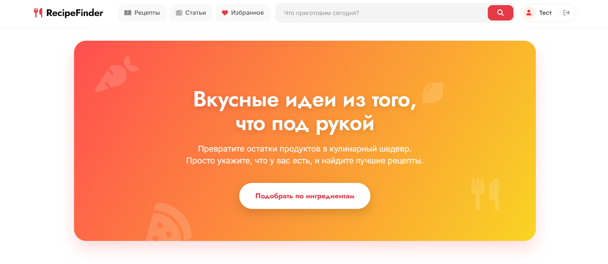
    
  
  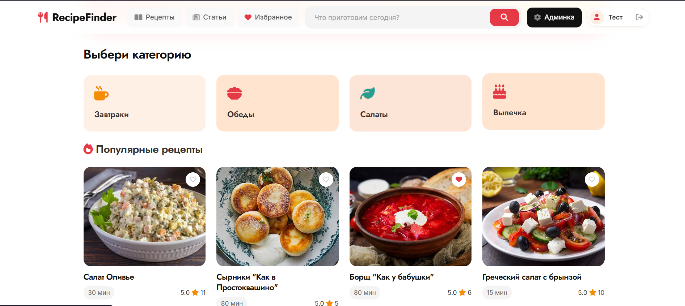
    
  
  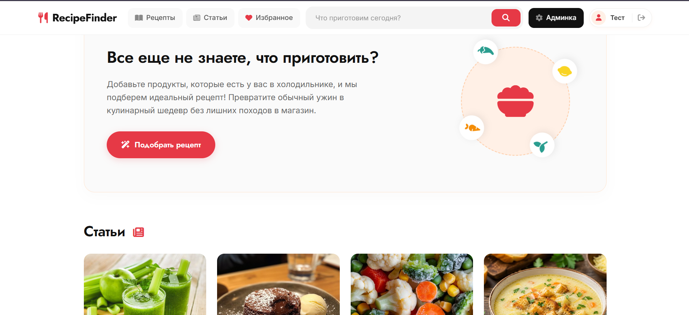
    
  
  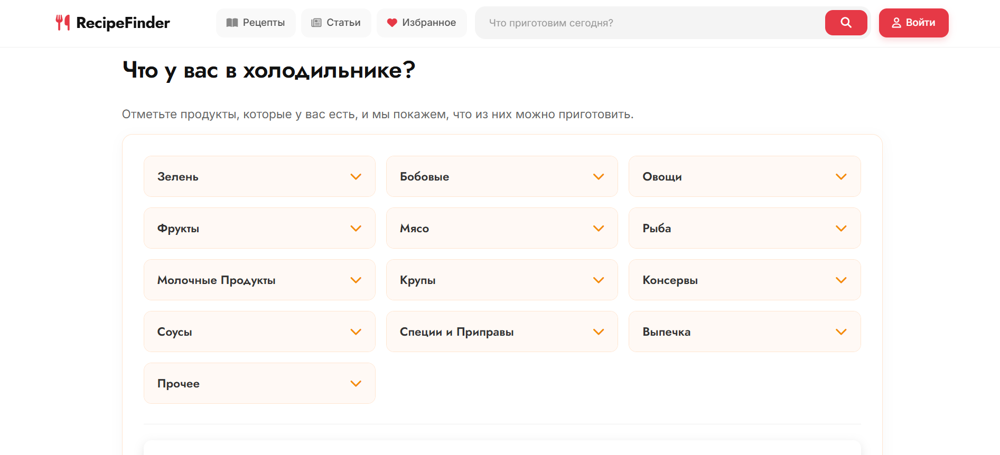
    
  
  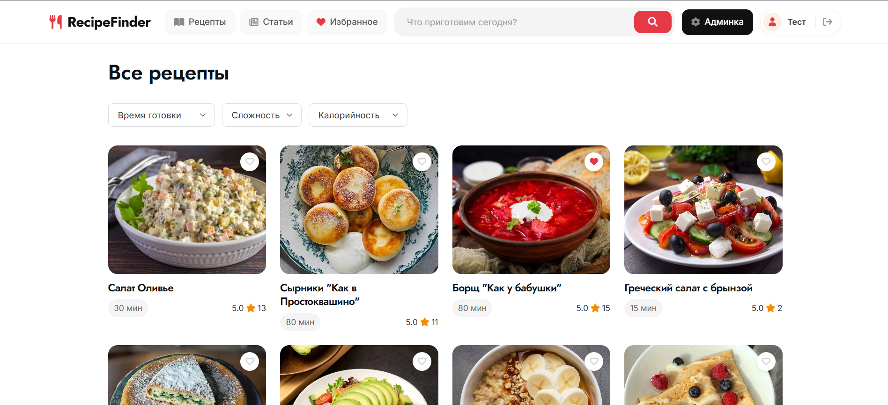
    
  
  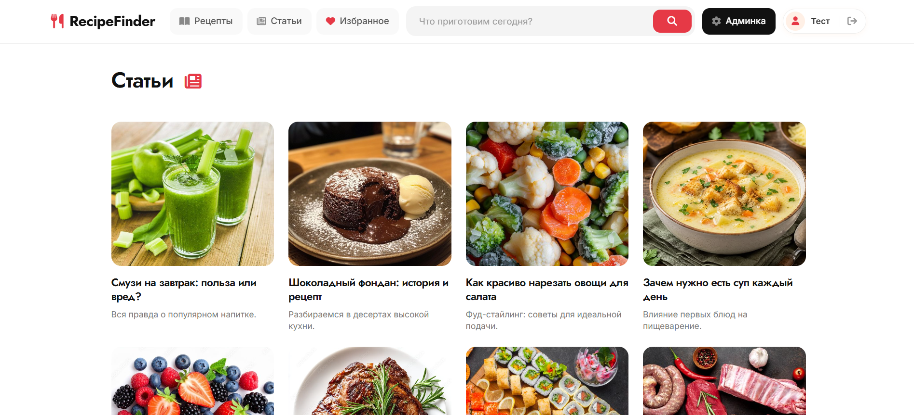
    
  
  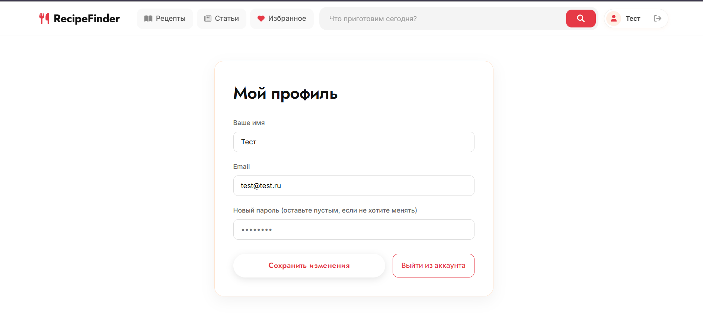
    
  
  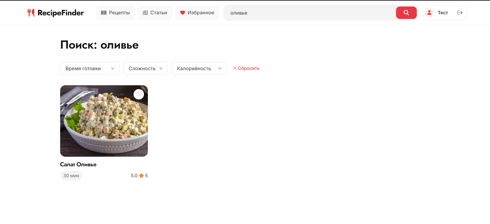
    
  
  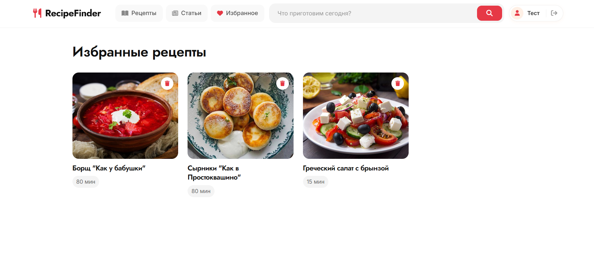
    
  
  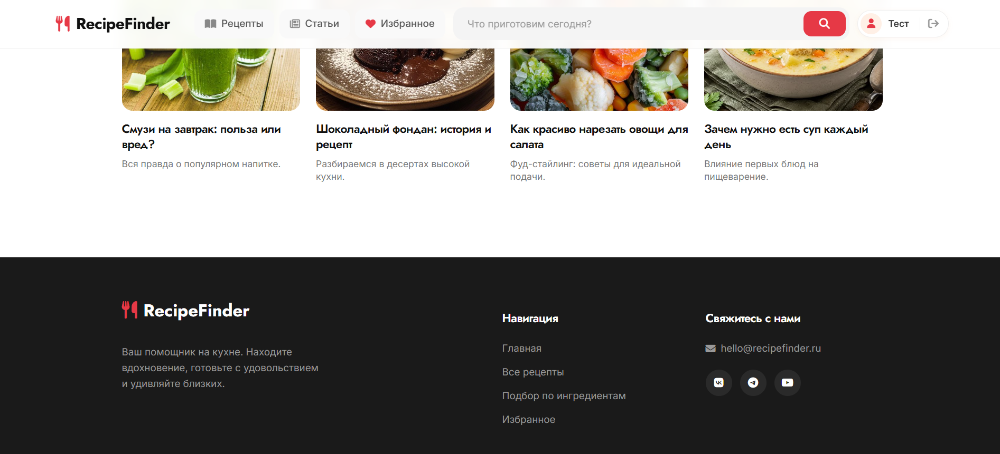
    
  
  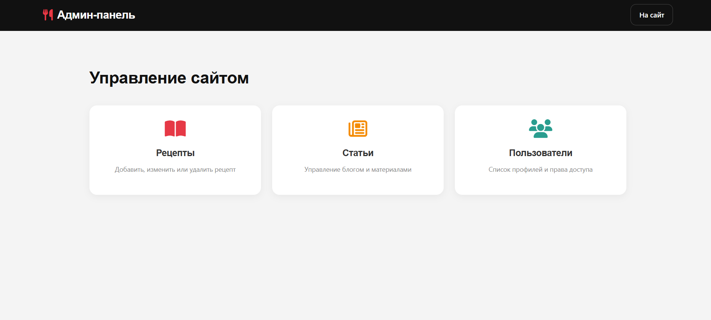
    
  
  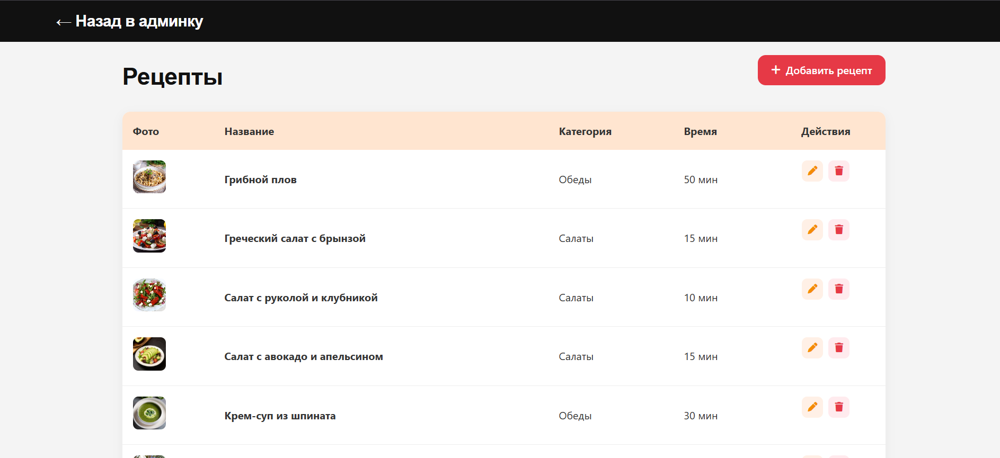
    
  
  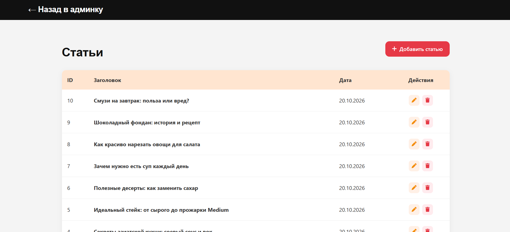
    

## О проекте

**RecipeFinder** — это платформа для любителей готовить. Проект включает в себя личный кабинет пользователя, умный поиск рецептов по ингредиентам, статьи и избранного, а также административную панель для управления контентом.

Ключевой функционал:
*    **Поиск и фильтрация:** поиск рецептов по названию, времени готовки, сложности и калорийности.
*    **Личный кабинет:** регистрация, авторизация, изменение данных, сохранение рецептов в «Избранное».
*    **Подбор по ингредиентам:** фича, которая позволяет выбрать продукты из холодильника и получить список подходящих блюд.
*   **Блог:** раздел со статьями о кулинарии и здоровом питании.
*    **Админ-панель:** полное управление рецептами, статьями и пользователями (CRUD).

## Как развернуть локально:
1. Создай новую базу данных в phpMyAdmin (например, `recipefinder`).
2. Импортируй в неё файл **`sql/recipefinder.sql`** (он лежит в корне проекта в папке `sql`).
3. В папке `config/` открой файл `db.php` и укажи свои локальные настройки (логин и пароль от БД).
4. Открой проект

## Технологии

*   **Backend:** PHP 8.x
*   **Frontend:** HTML5, CSS3, Vanilla JavaScript (Fetch API)
*   **База данных:** MySQL
*   **Сервер:** ISPmanager

---

